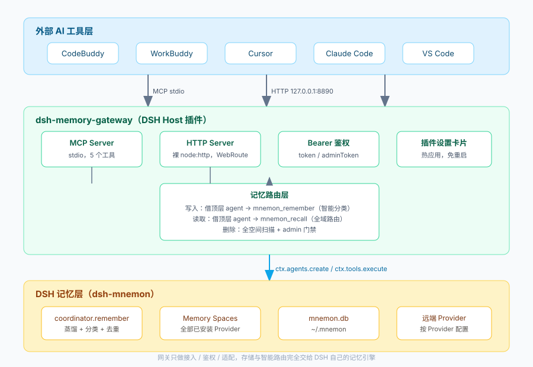

# dsh-memory-gateway — DSH 统一记忆网关

  

**把 DeepSeek Harness（DSH）变成所有外部 AI 工具的「中央记忆枢纽」的一个 Host 插件。**

外部工具（CodeBuddy、WorkBuddy、Cursor、Claude Code、VS Code …）通过 **HTTP** 或 **MCP（stdio）** 写入和检索记忆；而存储、去重、**智能分类路由**全部交给 DSH 自己的记忆引擎（`dsh-mnemon`）。网关只负责 **接入 + 鉴权 + 上下文桥接**，不重复实现一套记忆系统。

> 一句话：已有的共享方案解决「能不能共享」，本项目解决「**存得对不对、读得准不准**」。



---

## 目录

- [项目简介](#一项目简介)
- [核心特性](#二核心特性)
- [架构概览](#三架构概览)
- [快速开始](#四快速开始)
- [接入外部工具](#五接入外部工具)
- [HTTP API](#六http-api)
- [MCP 工具](#七mcp-工具)
- [配置项](#八配置项)
- [目录结构](#九目录结构)
- [运行自测](#十运行自测)
- [当前状态与已知限制](#十一当前状态与已知限制)
- [设计要点（维护者须知）](#十二设计要点维护者须知)
- [贡献与许可证](#十三贡献与许可证)

---

## 一、项目简介

不同的 AI 工具往往各自维护一份记忆：写的时候堆成一团、读的时候只能做关键词匹配，跨工具更是对不上。与此同时，DSH 内置的记忆引擎 `dsh-mnemon` 已经具备「蒸馏 → 分类 → 路由到合适的 Memory Space → 语义检索」的完整能力，却只服务于 DSH 自身的对话。

`dsh-memory-gateway` 补上了中间这一层：

- **对上**，用一套稳定的 HTTP API 和一个 MCP stdio 代理，把任意外部工具接进来；
- **对下**，借 DSH 的 agent 上下文调用 `mnemon_remember` / `mnemon_recall`，让每一条记忆都经过 DSH 原本的分类器，落到正确的空间，检索也走同一套语义引擎；
- **自己**，只做鉴权、参数适配与结果整形，尽量薄。

结果是：无论记忆从哪个工具进来，行为都和「直接在 DSH 里存一条」一致。

---

## 二、核心特性

| 特性 | 说明 |
| :--- | :--- |
| **智能分类写入** | 借顶层 DSH agent 让 `mnemon_remember` 走 Coordinator：蒸馏、分类、去重，落到最合适的 Memory Space，而不是原始字符串直存。 |
| **全域语义检索** | 由 DSH 记忆引擎（`mnemon_recall`）统一路由到**全部已安装的 Provider**（本地 mnemon 库、以及 Mem0 / Honcho / Hindsight 等远端 Provider），无需为每个后端单独写适配器。 |
| **双通道接入** | 同时提供 **HTTP**（绑定 `127.0.0.1`，默认端口 `8890`，并镜像到 DSH 自身 Web 端口）和 **MCP stdio** 代理，覆盖脚本 / hook 与各类 MCP 客户端。 |
| **本地鉴权** | 仅监听回环地址；首次启动自动生成随机 `token` 并持久化；除健康检查外全部需要 `Authorization: Bearer <token>`。 |
| **删除门禁** | 默认只有拥有者 `adminToken` 能删除；可在设置中放开。删除为软删除、单条操作，MCP 侧还要求 `confirm: true` 防误触。 |
| **可视化设置** | DSH 插件页与「设置 → 记忆网关」两处入口提供实时设置卡片，保存后立即生效、无需重启。 |
| **薄网关** | 不内置向量库、不自带模型、不复制记忆路由逻辑，全部委托给 DSH。 |

---

## 三、架构概览

```
外部 AI 工具层   CodeBuddy / WorkBuddy / Cursor / Claude Code / VS Code
        │  MCP stdio            │  HTTP 127.0.0.1:8890
        ▼                       ▼
dsh-memory-gateway（DSH Host 插件）
   MCP Server · HTTP Server · Bearer 鉴权 · 插件设置卡片
        └──────── 记忆路由层（借顶层 agent）────────┐
                                                    ▼
DSH 记忆层（dsh-mnemon）   coordinator.remember · Memory Spaces · mnemon_recall
```

写入和检索都通过 `ctx.agents` / `ctx.tools.execute` 借用 DSH 的 agent 身份完成，因此能复用引擎的全部能力。完整图示见 [docs/architecture.svg](./docs/architecture.svg)。

---

## 四、快速开始

### 前置条件

- 已安装 **DeepSeek Harness**，并启用 `dsh-mnemon` 记忆引擎；
- Host 侧提供 `@deepseek-ai/schemastery`（由 DSH profile 的 `node_modules` 提供）；
- **Node.js** `^22.19.0 || >=24.0.0`（仅编译 / 运行 MCP 代理需要）；
- 外部工具需与 DSH **运行在同一台机器**（网关仅监听回环地址）。

### 安装

**方式 A：从市场安装（推荐）**

上架包把 `package.json` 与 `lib/` **直接放在 ZIP 根目录**（不要多套一层文件夹）。

**方式 B：本地开发安装**

```bash
# 1. 编译（TypeScript → lib/）
npm install
npm run build

# 2. 把本仓库链接进 DSH profile，并在 profile 的 cordis.patch.yml 里加入：
#      - insert:
#          - id: dsh-memory-gateway
#            name: dsh-memory-gateway
```

编译脚本 `build_sync.cmd`（Windows）会顺带把 `client.js` 同步到 `lib/client.js`，并在 profile 为真实副本时同步 `lib/` 产物。

重载插件（必须是 `POST`）：

```bash
curl -X POST "http://127.0.0.1:<DSH_WEB_PORT>/dsh-unlag/reload?requestId=<任意id>" \
  -H "x-dsh-unlag: 1"
```

启动成功后，`GET /api/health` 会返回版本号与生效中的设置；`token` 写在 `<DSH_HOME>/memory-gateway.state.json`（首次启动自动生成，可由 `tokenFile` 覆盖）。

---

## 五、接入外部工具

更完整的分步说明见 [docs/EXTERNAL-SETUP.md](./docs/EXTERNAL-SETUP.md)。

### HTTP 示例

```bash
TOKEN="<你的 token>"

# 写入（智能分类，异步返回 202 accepted）
curl -X POST http://127.0.0.1:8890/api/remember \
  -H "Authorization: Bearer $TOKEN" -H "Content-Type: application/json" \
  -d '{"content":"用户偏好使用 pnpm","source":"cursor"}'

# 检索
curl -X POST http://127.0.0.1:8890/api/recall \
  -H "Authorization: Bearer $TOKEN" -H "Content-Type: application/json" \
  -d '{"query":"包管理器偏好","limit":5}'
```

> Windows 下请求体含中文时请用 `--data-binary @file.json`（文件存 UTF-8），直接命令行 `-d '中文'` 可能被转成 GBK 导致乱码。

### MCP 配置

把 stdio 代理加入客户端的 MCP 配置（`token` / 端口可用环境变量覆盖，也可让它自动读状态文件）：

```json
{
  "mcpServers": {
    "dsh-memory": {
      "command": "node",
      "args": ["<插件目录>/lib/mcp-server.js"],
      "env": {
        "DSMG_TOKEN": "<你的 token>",
        "DSMG_PORT": "8890",
        "DSMG_HOST": "127.0.0.1"
      }
    }
  }
}
```

支持的环境变量：`DSMG_TOKEN`、`DSMG_PORT`、`DSMG_HOST`、`DSMG_STATE`（指向状态文件）。

stdio 传输在同一管道上同时支持两种分帧：官方 `Content-Length` 头分帧与 MCP 规范的裸换行分隔 JSON，并且**用哪种格式收到就用哪种格式回复**，兼容不同客户端。

---

## 六、HTTP API

除 `/api/health` 与 `/api/config` 外，全部需要 `Authorization: Bearer <token>`。

| 方法 | 路径 | 请求体 | 说明 |
| :--- | :--- | :--- | :--- |
| GET | `/api/health` | — | 公开；版本、token 前缀、生效设置 |
| GET | `/api/config` | — | 公开；脱敏后的生效设置（不含密钥） |
| POST | `/api/config` | `{ confirm: true, allowExternalDelete?, adminToken?, defaultSpace? }` | 保存并立即生效；`confirm` 必填 |
| POST | `/api/remember` | `{ content, source?, hintSpace?, category?, importance?, tags?, entities? }` | 由 mnemon Coordinator 智能路由，返回 `202 accepted` 后异步写入 |
| POST | `/api/write-direct` | `{ content, hintSpace, source? }` | 直接写指定空间，不做分类 |
| POST | `/api/recall` | `{ query, space?, limit?, mode? }` | 不传 `space` 则跨全部空间检索；返回扁平信封 `{ query, mode, searchedSpaces, results[] }` |
| GET | `/api/spaces` | — | 列出所有 Memory Space |
| POST | `/api/forget` | `{ id, memoryBodyId? }` | **破坏性**：软删单条；门禁见「核心特性」 |

没有批量删除：一次调用只删一个 id，MCP 侧还额外要求 `confirm: true`。

---

## 七、MCP 工具

`lib/mcp-server.js` 是薄代理，暴露 5 个工具，与 HTTP 端点一一对应：

| 工具 | 说明 |
| :--- | :--- |
| `memory_remember` | 智能分类写入；`content` 必填 |
| `memory_recall` | 智能检索；`query` 必填，`space` / `limit` / `mode` 可选 |
| `memory_write_direct` | 直写指定空间（跳过分类） |
| `memory_spaces` | 列出所有可用 Memory Space |
| `memory_forget` | 删除一条；需 `{ id, confirm: true }`，`space` 留空会自动扫遍所有空间 |

命令行下也可直接验证（不依赖 MCP 宿主）：

```bash
node tests/mcp-cli.mjs list
node tests/mcp-cli.mjs recall "某段记忆"
node tests/mcp-cli.mjs remember "一条长期事实"
node tests/mcp-cli.mjs forget <完整uuid>
```

---

## 八、配置项

| 键 | 默认值 | 含义 |
| :--- | :--- | :--- |
| `port` | `8890` | 本地 HTTP 端口（绑定 `127.0.0.1`） |
| `token` | `""` | Bearer token；留空则自动生成并持久化到 `tokenFile` |
| `tokenFile` | `""` | 状态文件；默认 `<DSH_HOME>/memory-gateway.state.json` |
| `defaultSpace` | `default` | 调用方未指定空间时的兜底目标 |
| `asyncWrite` | `true` | `/api/remember` 返回 `202 accepted` 后后台写入 |
| `adminToken` | `""` | 拥有者专属密钥；外部删除关闭时 `/api/forget` 必须它 |
| `allowExternalDelete` | `false` | 关 ⇒ 只有 `adminToken` 能删；开 ⇒ 共享 token 也能删 |
| `mnemonCli` | `""` | 可选的 mnemon CLI 路径，用于删除回退 |

> 从 v0.4.2 起，召回由 DSH 记忆引擎（`mnemon_recall`）统一路由到全部已安装 Provider，不再需要为单个后端配置端点——装好对应 Provider 即自动生效。

配置优先级：插件页设置 > 插件 Config（`cordis.yml`）> 默认值。插件页保存的值落在 `memory-gateway.config.json`，重启后仍在。

---

## 九、目录结构

```
dsh-memory-gateway/
├── package.json            # dsh.bundle.patch + type:module + main:lib/index.js
├── cordis.patch.yml        # 最小 Loader insert
├── tsconfig.json
├── client.js               # 插件页卡片源码（构建时同步到 lib/client.js）
├── src/index.ts            # 网关主体：HTTP + DSH Web 路由 + agent 桥接
├── src/mcp-server.ts       # MCP stdio 代理源码
├── lib/                    # 编译产物（DSH 实际加载）
│   ├── index.js  mcp-server.js  client.js  admin.html
├── docs/
│   ├── EXTERNAL-SETUP.md   # 外部工具接入指南
│   ├── architecture.svg    # 架构图
│   └── market-entry.yml    # 市场上架信息
├── tests/                  # 自测脚本（fake ctx，无需 DSH 在线）
├── tools/sync-profile.mjs  # 把 lib/ 同步到 profile 的辅助脚本
└── LICENSE                 # MIT
```

---

## 十、运行自测

全部基于 fake ctx，纯本地运行，不需要 DSH 或 mnemon 在线：

```bash
node tests/e2e-mock.mjs          # HTTP 端点 + 鉴权 + 202 异步语义
node tests/e2e-mock-phase2.mjs   # 借顶层 agent 走 mnemon 智能路由
node tests/mcp-e2e.mjs           # MCP 五工具 schema + 分帧
node tests/run-client.mjs        # 客户端两处 slot 注册
node tests/spaces-check.mjs      # /api/spaces 不依赖 pinned View
node tests/recall-shape.mjs      # /api/recall 返回扁平信封（防回归）
node tests/forget-check.mjs      # forget 404 + searchedSpaces（需网关在线）
```

---

## 十一、当前状态与已知限制

本项目以「能跑通完整闭环、并对社区开放二次开发」为目标，使用时请注意：

- **全域召回仍在完善**：v0.4.2 把检索改为「借顶层 agent 在真实 turn 内调用 `mnemon_recall`」以覆盖全部 Provider。该路径在本机实测中存在**超时 / 返回空结果**的情况，尚在调优；如需稳定检索，可关注后续版本或回退使用更早版本的本地 CLI 检索路径。写入、删除、鉴权、MCP 接入等链路均已验证可用。
- **仅本机可用**：网关只监听 `127.0.0.1`，外部工具必须与 DSH 同机。跨机器需自行加反向代理并承担安全风险。
- **MCP 仅 stdio**：尚未提供 SSE / Streamable HTTP 传输。
- **依赖 DSH 环境**：需要 Host 侧已装 `dsh-mnemon` 与 `@deepseek-ai/schemastery`，本插件不自带记忆引擎与模型。

欢迎针对以上限制提交 Issue 或 Pull Request。

---

## 十二、设计要点（维护者须知）

以下是在 DSH 插件体系下踩过的坑，供二次开发参考：

- **必须借「活的」agent**：`mnemon_*` 工具内部调用 `requireAgent(exec)`，没有 ambient session 会抛 `Mnemon semantic operations require a live DSH agent`。网关用 `ctx.agents.create({ ... })` 造 agent，再用 `ctx.agents.withInitiator(agent, ...)` 把工具调用包进它的身份。
- **智能路由需要顶层 agent**：`mnemon_remember` 按 `isSubagent(exec.agent)`（判断 `agent?.session?.header?.origin === "subagent"`）分叉——subagent 走裸写跳过分类，顶层 agent 才走 `coordinator.remember` 做蒸馏分类。借错身份会让记忆变成「原始字符串直存」。
- **`mnemon_recall` 的 pinned view 门禁**：该工具硬编码 `requirePinnedView: true`，`withInitiator` 伪造不出 pinned turn，会抛 `Recall requires the View pinned to the current turn`。v0.4.2 起靠 `agent.followup()` 唤醒一个真实 turn 让 agent 自己调 `mnemon_recall`，事后从 `session.surface.nodes` 截取 `tool/result`（不耦合私有 RPC、又能覆盖全部 Provider 的公开路径）。借来的 agent 没有 pinned view，全局召回必须显式传全部 `memoryBodyIds`。
- **删除不需 pinned turn**：`mnemon_forget` 走 `coordinator.write`，零 token 消耗；失败时回退原生 mnemon CLI。
- **DSH 插件 API 细节**：`@deepseek-ai/schemastery` 是默认导出且没有 `z.infer`（类型需手写）；`ctx.effect` 是「工厂返回 disposer」即 `ctx.effect(() => () => server.close())`；`ctx.tools.execute` 的参数字段是 **`arguments`** 而非 `input`，且**必须传 `signal: AbortSignal`**，否则报 `Cannot read properties of undefined (reading 'aborted')`。
- **ESM 与跨平台**：插件里不能用 `require`，要 `await import()`；Windows 下 `execFileSync` 不搜 PATH，`.cmd` 需 `shell: true`；插件页卡片注册必须走 `ctx.slots.inject(slotName, () => ctx.slots.register(...))`，直接 `register()` 在槽未声明时会抛、被外层 try/catch 吞掉后表现为「卡片不出现」。

---

## 十三、贡献与许可证

欢迎提交 Issue、改进文档、补充客户端接入示例，或针对「已知限制」贡献修复。提交前请先跑一遍 `npm run build` 与 `tests/` 下的自测。

- 许可证：**MIT**，见 [LICENSE](./LICENSE)。
- 市场上架信息：[docs/market-entry.yml](./docs/market-entry.yml)。
- 外部工具完整接入指南：[docs/EXTERNAL-SETUP.md](./docs/EXTERNAL-SETUP.md)。
